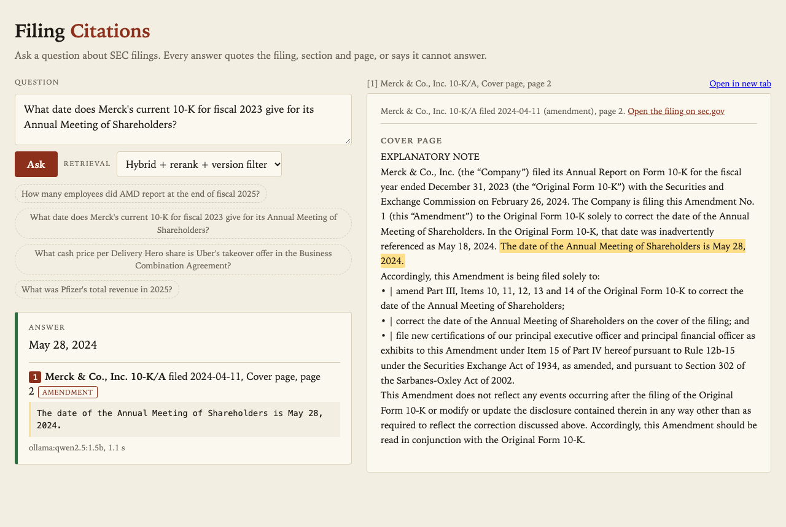
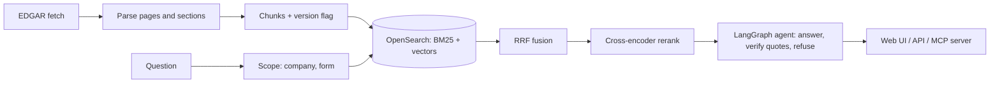

# filing-citations

Question answering over public SEC filings for people who need a quotable source: every answer cites the filing, section and page, and the system says so when the filings do not support an answer. A personal project on public EDGAR data (26 companies, 195 filings, 10-K, 10-K/A, 10-Q, 8-K with exhibits).

Topics: rag, sec-edgar, opensearch, langgraph, hybrid-search, reranking, citations, mcp, evaluation, llm



## Results

Golden set: 128 questions written from the filings, each with a verbatim evidence quote (32 are unanswerable). Commands: `make eval-retrieval` and `make eval`, tables filled by `make report`. Latency includes the model call.

<!-- results:start -->

**Retrieval only (no model)**

| Configuration | Evidence recall@8 | All evidence found@8 | MRR | Stale hits (version traps) | Retrieval p50 / p95 |
|---|---|---|---|---|---|
| BM25 only | 0.66 | 0.65 | 0.53 | 17% | 10 / 20 ms |
| Dense only | 0.61 | 0.59 | 0.45 | 22% | 36 / 56 ms |
| Hybrid (RRF) | 0.72 | 0.68 | 0.51 | 20% | 44 / 53 ms |
| Hybrid + rerank | 0.65 | 0.59 | 0.53 | 15% | 297 / 375 ms |
| Hybrid + rerank + version filter | 0.65 | 0.59 | 0.53 | 10% | 307 / 370 ms |

**Answers**

Model: `ollama:qwen2.5:1.5b`

| Configuration | Answer correctness | Citation precision | Quote verbatim | Refusal accuracy (unanswerable) | False refusals | p50 / p95 |
|---|---|---|---|---|---|---|
| BM25 only | 0.33 | 0.51 | 1.00 | 0.44 | 0.30 | 6.0 / 8.9 s |
| Dense only | 0.32 | 0.54 | 1.00 | 0.62 | 0.39 | 6.7 / 10.8 s |
| Hybrid (RRF) | 0.38 | 0.53 | 1.00 | 0.66 | 0.27 | 6.7 / 10.5 s |
| Hybrid + rerank | 0.35 | 0.61 | 1.00 | 0.59 | 0.34 | 7.0 / 11.0 s |
| Hybrid + rerank + version filter | 0.34 | 0.63 | 1.00 | 0.62 | 0.32 | 6.9 / 11.4 s |

<!-- results:end -->

Answer metrics use only the local model named above. No Claude or Bedrock key was available, so those columns are not reported for them. Retrieval metrics need no model.

## How it works



Filings are split on their own page breaks and Item headings into chunks with company, form, period, filed date and version. A section counts as superseded when a later amendment of the same period has it. Search fuses BM25 and vectors with RRF, then a cross-encoder reranks the top 30. The agent has the model answer with quotes, checks each quote against the cited page, drops any that are not verbatim, and refuses when none survive.

## Design choices

- **Versions per section.** A Part III only 10-K/A does not replace the financials, so "current" is decided per section. A filing-level flag was tried and dropped.
- **Quotes are checked in code.** A small model paraphrases, so near-verbatim quotes snap to the real sentence and everything else is dropped.
- **Company and form scope in every config.** The table then isolates retrieval and the version filter, which only the last row adds.
- **RRF, not score blending.** BM25 and cosine scores are not comparable and rank fusion needed no tuning.
- **The reranker lowered recall here.** The MS MARCO cross-encoder cut evidence recall@8 against plain hybrid. The table keeps that result.

## Run it

```bash
make setup                 # Python 3.12 or 3.13 virtualenv
make demo                  # OpenSearch on :9201 (Docker) + 8 sample filings + 4 questions
make ui                    # web page on http://127.0.0.1:8100 (after make demo)
make demo-lite             # no Docker, no model: in-memory search and an offline stub
```

`make demo` uses a local Ollama model if one is running (`brew install ollama; ollama pull qwen2.5:1.5b`) and the offline stub otherwise. The stub does not answer: it returns the best-matching sentence from the top result, so its output is often an unrelated quote. The UI screenshot above was taken with Ollama qwen2.5:1.5b, not the default demo. No API keys needed. Keys switch on the full path: set `FC_LLM=anthropic` with `ANTHROPIC_API_KEY`, or `FC_LLM=bedrock` with AWS credentials.

Full corpus: copy `.env.example` to `.env`, set `SEC_USER_AGENT` to your name and email (SEC fair access, the fetcher stays under 8 requests per second), then `make fetch parse index` and `make eval`. `make down` stops OpenSearch and removes its volume.

MCP server for other AI apps: `python -m filingcite.mcp_server` exposes `search_filings`, `get_section` and `compare_versions`.

## Tests

`make test` runs 40 pytest tests (parser, version flags, retrieval, agent refusal, API, MCP, and a check that every golden evidence quote is verbatim in the committed sample page). On a cold clone 39 run and 1 is skipped, the check against the full parsed corpus, which needs `make fetch parse index`. Without OpenSearch running, the OpenSearch test is skipped too (38 run, 2 skipped). `make lint` runs ruff. CI runs both on Python 3.12 and 3.13 with an OpenSearch service.

## What I'd do next

- Add an entity check: the 1.5B model answered the JPMorgan demo question with a verbatim but unrelated AMD quote, so a verified quote is not yet proof of relevance.
- Tune the reranker pool and try a larger or fine-tuned reranker, since it cost recall.
- Add a query planner so comparison questions fetch each year separately.
- Run the answer table with a Claude model and a 7B local model and compare.
- Parse tables into rows with column headers so numeric quotes carry their year.
